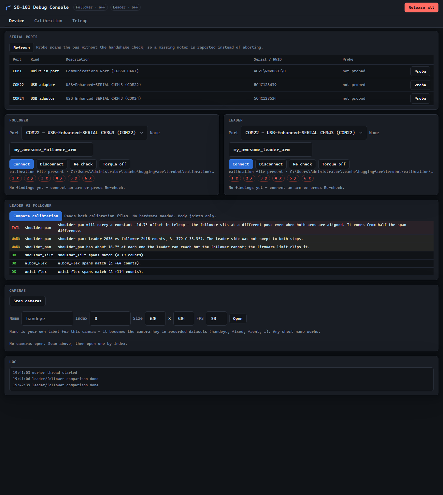
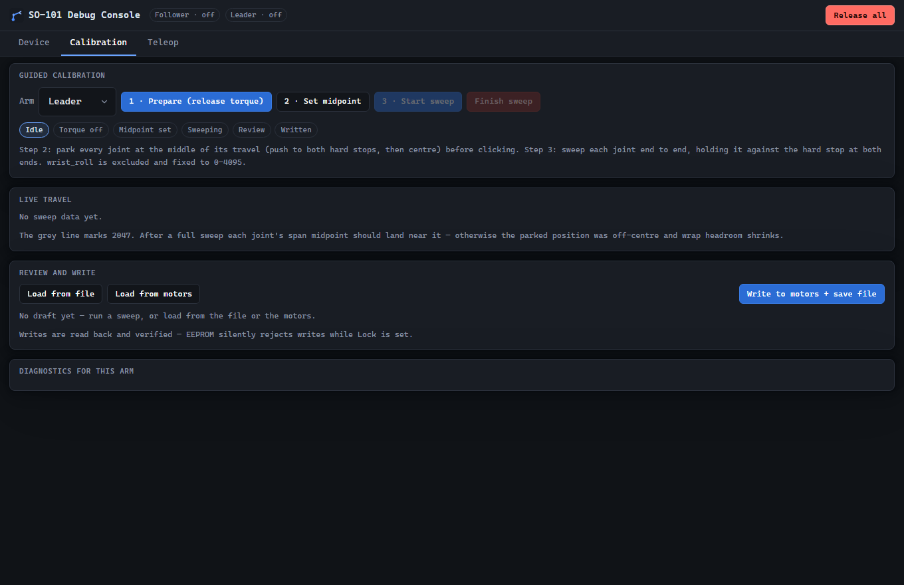
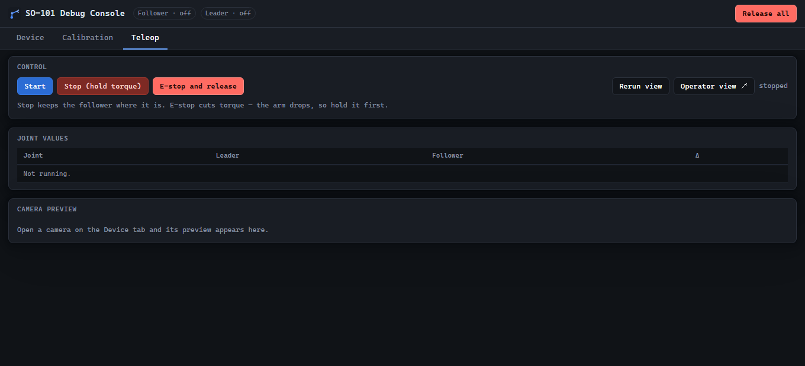

<p align="center">
  
</p>

<h1 align="center">so101-console</h1>

<p align="center">
  A local web console for the SO-101: <b>device health check · guided calibration · teleop</b>
</p>

---

It replaces the parts of the CLI workflow that are awkward in a terminal — reading
a scrolling MIN/POS/MAX table by eye while sweeping a joint, working out whether a
span is short enough to matter, or getting nothing but `Missing motor IDs: - 6`
when the gripper drops off the bus.



## Where it lives

This is a standalone repository, but it is meant to be checked out **inside a
lerobot checkout**, at `tools/debug_console/`:

```
lerobot/                        <- an ordinary lerobot checkout
├── src/lerobot/                <- upstream, never modified by this console
├── pyproject.toml
└── tools/
    └── debug_console/          <- this repo, cloned here
        ├── app/
        ├── vendor/             <- motor layer copied out of src/lerobot/
        └── .venv/              <- its own environment
```

Placing it there is what lets `vendor/sync_vendor.py` re-copy the motor layer from
`../../src/lerobot/` and keep the vendored copy in step with upstream. The console
borrows upstream's code layout, calibration file format and
`HF_LEROBOT_CALIBRATION` paths — while writing nothing back into `src/`.

The console itself is self-contained at runtime; only re-syncing needs the lerobot
tree.

## Install

You need a [lerobot](https://github.com/huggingface/lerobot) checkout and
[uv](https://docs.astral.sh/uv/) on `PATH`.

```powershell
cd <your-lerobot-checkout>

git clone https://github.com/jzx05/so101-console tools\debug_console
uv venv tools\debug_console\.venv --python 3.12
uv pip install --python tools\debug_console\.venv\Scripts\python.exe -r tools\debug_console\requirements.txt
```

> `--python` is not optional: if `CONDA_PREFIX` is set, a bare `uv pip install`
> targets the conda base environment instead of the console's venv.
>
> If PyPI is slow from where you are, add a mirror:
> `--index-url https://pypi.tuna.tsinghua.edu.cn/simple`

## Run

From the lerobot checkout root:

```powershell
tools\debug_console\.venv\Scripts\python.exe tools\debug_console\run.py
```

Then open <http://127.0.0.1:8000>. `--port 8765` changes the port, `--host 0.0.0.0`
exposes it on the network.

**Ctrl+C exits and releases torque and closes the serial ports.**

A tab can be bookmarked with a query parameter: `/?tab=calib` or `/?tab=teleop`.

## Why its own environment

**Separate virtualenv, no torch, and the project's `.venv` is never touched.**

This is deliberate. `src/lerobot/utils/__init__.py` unconditionally imports
`device_utils`, whose line 20 is a bare `import torch` — so importing *any* lerobot
hardware module drags torch in, even just to read a serial port. The console
vendors the motor layer it actually needs instead (see `vendor/VENDOR.md`):

| | project `.venv` | console `.venv` |
|---|---|---|
| torch | 2.11.0+cu128 (hand-installed) | **none** |
| import time at startup | ~10 s | < 1 s |
| effect of this tool on it | **zero** | — |

## Tabs

### Device

* **Serial ports** — listed with a locale-independent kind and the serial number.
  Two CH343 adapters look identical otherwise; the serial number tells them apart.
  A built-in port is labelled as such, because it can never drive a Feetech bus —
  it cannot reach 1 Mbaud, which is why probing COM1 always fails.
* **Probe** — scans the bus *without* the handshake check, so a missing motor is
  **reported by name** instead of aborting with `RuntimeError` the way `lerobot-*`
  does. This is the most useful thing here when something falls off the bus.
* **Leader vs follower** — compares the two calibration files. Needs no hardware,
  and is what the screenshot above shows: a real under-swept `shoulder_pan` that
  would otherwise take two terminal tables and mental arithmetic to spot.
* **Cameras** — one scan button; `fps` showing 0 is normal, DSHOW does not report a
  frame rate until the stream starts.

### Calibration



Four steps, all buttons, no Enter key anywhere:

1. **Prepare** — release torque, switch to position mode.
2. **Set midpoint** — park every joint at the middle of its travel (push to both
   hard stops, then centre) and click.
3. **Start sweep** — push each joint from end to end, holding it against the hard
   stop at both ends. The live table draws the min/pos/max bar as you go.
4. **Write** — diagnostics run automatically, then the values go to the motors and
   the JSON file.

Writes are **read back and verified**: EEPROM silently rejects writes while `Lock`
is set, so a mismatch is reported rather than assumed fine.

### Teleop



Start/stop, a live joint table, camera previews, torque control, and an e-stop.

The two stop buttons differ:

* **Stop (hold torque)** — the follower freezes in place.
* **E-stop and release** — cuts torque; the arm drops, so hold it first.

E-stop goes through its own channel (it sets a `threading.Event` directly, never
through the command queue). Otherwise it would sit behind a slow bus call — and
with a motor missing, one `sync_read` waits out three timeouts.

## Streaming to Rerun

**Rerun view** in the teleop tab opens the Rerun desktop viewer and streams live
joint values as time series plus camera frames as images — the same thing
`lerobot-teleoperate --display_data=true` gives you. The console cannot shell out
to that command, since it holds the serial ports itself, so it feeds the viewer
from its own teleop loop.

Two details that make it work without fuss:

* The viewer binary ships inside the `rerun-sdk` wheel, next to the interpreter.
  The SDK otherwise searches `PATH`, which fails unless the venv is activated, so
  the path is passed to `spawn()` explicitly.
* Camera frames are reused from the MJPEG pipeline and their JPEG encoding is
  cached per frame, so the teleop loop never re-encodes at 30-60 Hz.

## Operator view

**Operator view ↗** opens a stripped-down page in its own window: cameras as large
as possible, a compact joint readout, nothing else. Drag it to a second monitor and
full-screen it while teleoperating. It shares the console's state stream, so it
stays in step.

## Diagnostics

These run on the Device and Calibration tabs. The thresholds are not arbitrary;
each came out of a real debugging session.

| Rule | Criterion | Why |
|---|---|---|
| `SPAN_SHORT` / `SPAN_LOW` | Body joint span < 2000 counts (healthy: 2200-2500) | 12-bit encoder, 4096 counts = 360°. A span can never exceed the real mechanical travel, so a small one means an end never reached its stop |
| `WRAP_LOW` / `WRAP_HIGH` | `range_min` within 250 counts of 0, or `range_max` within 250 of 4095 | Crossing zero makes the reading jump a full turn; the follower whips around |
| `MID_OFFSET` (single arm) | `(min+max)/2` more than 150 counts from 2047 | **Wrap headroom only.** Normalization zeroes on the swept `(min+max)/2`, not on 2047 |
| `SPAN_MISMATCH` | Leader/follower span gap > 150 counts | One side was under-swept |
| `PAIR_MID_OFFSET` | Half the span gap, as an angle: warn > 5°, fail > 15° | This is the constant offset actually injected into teleop |
| `REACH_CLIP` | Same figure, in degrees | At each end the leader reaches further than the follower, and the firmware limit clips it |
| `MOTOR_MISSING` | An expected ID did not answer | Names the joint and points at the daisy chain |
| `MODEL_MISMATCH` | Wrong model number | Wrong motor type |

**Why the gripper is excluded from the pair comparison:** both arms' grippers use
`MotorNormMode.RANGE_0_100`, so they map as "each arm's own percentage of its own
range" and their spans are not supposed to match. Body joints use `DEGREES`, where
counts map one-to-one.

**Why half the span gap and not a difference of midpoints:** the two arms' raw
encoder frames are not aligned — different mounting, different homing offsets — so
raw values cannot be subtracted across arms. The derivation is in the `check_pair`
docstring in `app/diagnostics.py`.

The wording is not in the Python. A diagnostic is a machine-readable `code` plus
the numbers behind the verdict, and the sentence is built in the `MESSAGES` map in
`static/app.js`. That keeps `app/diagnostics.py` pure and testable (the tests
assert on `code` + `data`, not on prose).

## Caveats

* **Serial ports are exclusive.** While the console holds a port, no other program
  may open it — not `lerobot-teleoperate`, not `lerobot-calibrate`. Cameras are
  exclusive too, so close them in one place before opening them in another.
* **Cameras share bandwidth with everything else.** A typical machine has one USB
  host controller, so both cameras and both serial adapters sit on the same bus.
  Previews default to 12 fps; drop a camera to 320x240 if frames start dropping.
* **Calibration files are fully interchangeable** with `lerobot-calibrate`, and the
  test suite cross-checks the format.
* **Enumerating motors uses per-motor pings, never `broadcast_ping`.** A broadcast
  makes every motor answer at once, so the replies collide. Measured with both arms
  online: broadcast got 0-1 motors in 1576 ms; per-motor pings got 6 in 5 ms.
* Backend changes need a **server restart** — Python modules load at startup, unlike
  the HTML/JS/CSS, which are read from disk on every request.
* The console **does not touch `src/`**, so `git pull` upstream never conflicts.

## Layout

```
so101-console/
├── run.py                 entry point
├── app/
│   ├── main.py            FastAPI routes, SSE, MJPEG
│   ├── worker.py          background thread: owns the ports, command queue + state
│   ├── hardware.py        bus wrapper (connect, enumerate, read/write calibration)
│   ├── calibration.py     travel sweep (replaces the stdin-driven upstream version)
│   ├── diagnostics.py     the rules (pure functions, no hardware)
│   ├── cameras.py         enumeration, reader threads, MJPEG
│   ├── rerun_log.py       live streaming to the Rerun viewer
│   └── paths.py           calibration file paths (mirrors upstream)
├── vendor/                motor layer copied from upstream, see VENDOR.md
├── static/
│   ├── index.html         the console
│   ├── operator.html      the pop-out operator view
│   ├── app.js             EventSource + fetch, no framework; holds the wording
│   ├── style.css          app styles on top of Pico
│   ├── vendor/pico.min.css
│   └── assets/favicon.svg
├── docs/screenshots/
└── tests/                 98 tests; most need no hardware
```

## Maintenance

Re-sync the vendored motor layer after upstream changes:

```powershell
tools\debug_console\.venv\Scripts\python.exe tools\debug_console\vendor\sync_vendor.py
```

The lerobot checkout is found automatically when this repo sits at
`<lerobot>/tools/debug_console`. Anywhere else, point at it:

```powershell
... sync_vendor.py --lerobot C:\path\to\lerobot
```

It re-copies, re-applies the three import patches, and runs a "no torch" check. If
upstream rewrote those imports the script **fails loudly rather than producing a
broken copy**.

Run the tests:

```powershell
cd tools\debug_console
.venv\Scripts\python.exe -m pytest -q
```
